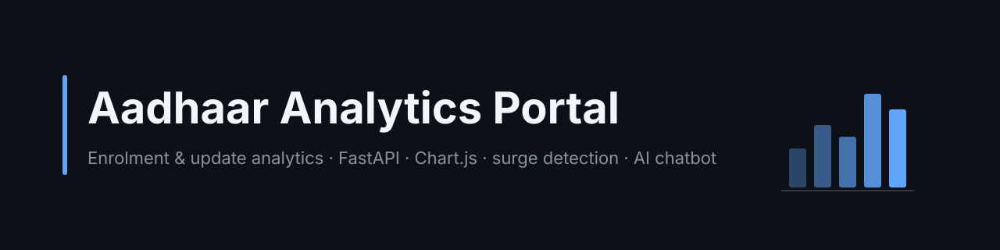
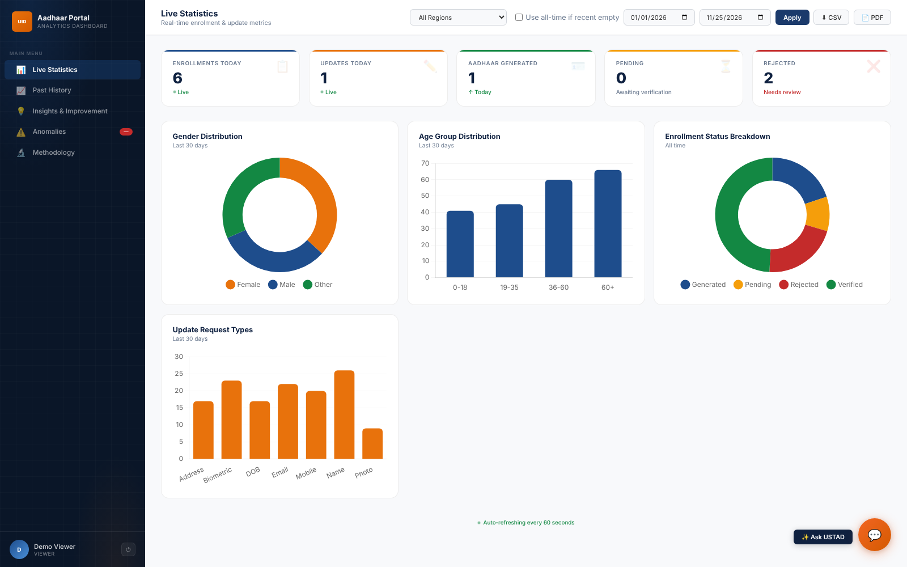
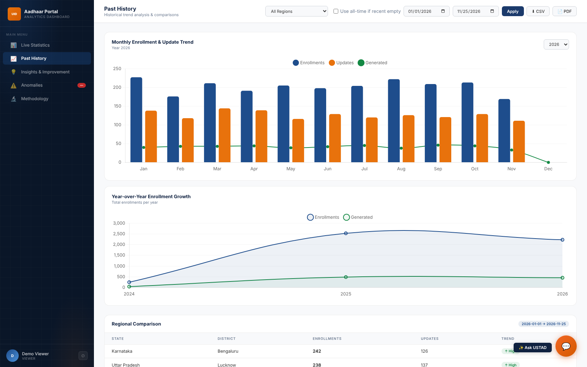
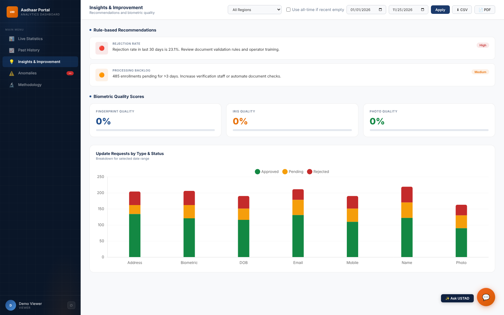
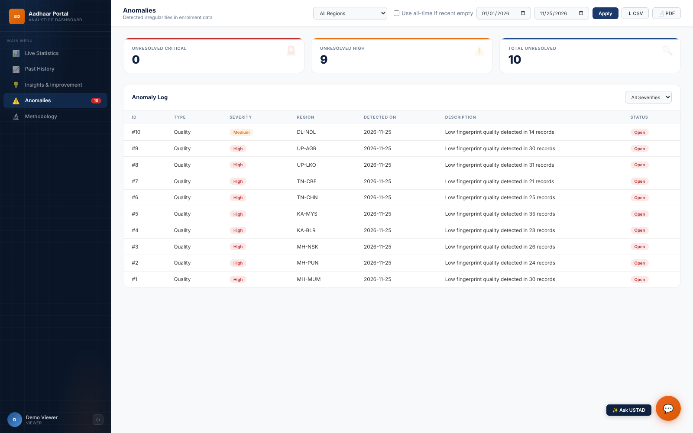
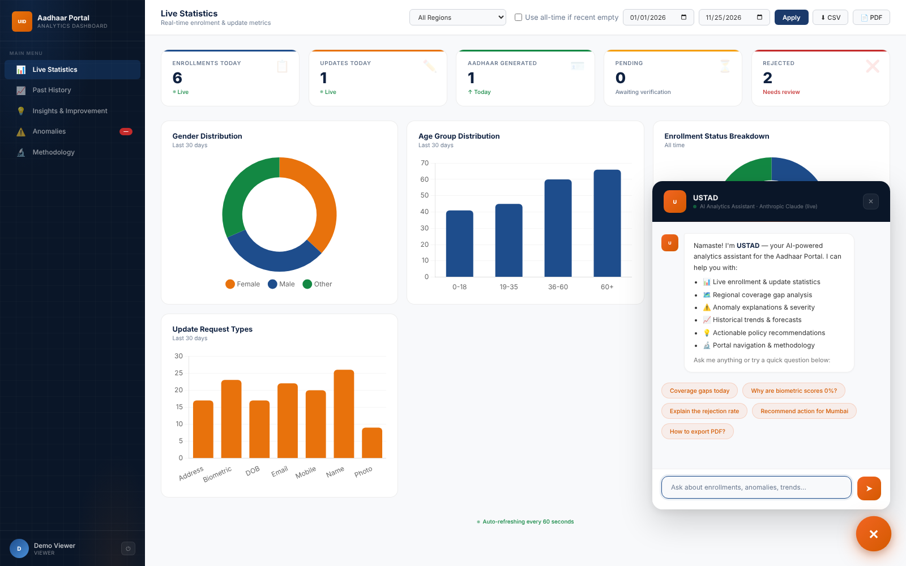
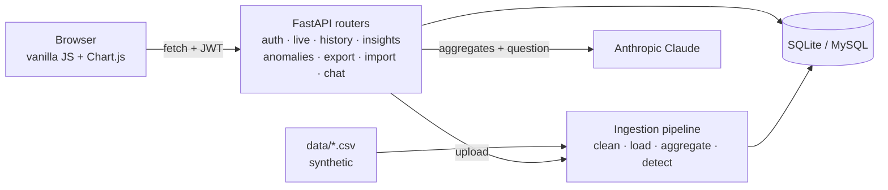

<p align="center">
  
</p>

<p align="center">
  <a href="https://github.com/shraddhauser/aadhaar-analytics-portal/actions/workflows/ci.yml"></a>
  
  
</p>

A web dashboard for exploring Aadhaar enrolment, demographic-update and
biometric-quality data: live KPIs, historical trends, rule-based
recommendations, enrolment-surge detection, and a chatbot that answers
questions about the numbers on screen. It was built as a four-person
academic team project ("Unlocking Societal Trends in Aadhaar Enrolment and
Updates") and is a **working prototype running on synthetic data**: no real
UIDAI data is included. The backend has 110 automated tests with 75% line coverage
(source: `pytest --cov=backend`, see [Results](#results)).

## Demo



- **Live demo:** `TODO: add the Render URL after deploying` (log in as `demo` /
  `TODO: demo-only password`). The demo is read-only, runs on synthetic data,
  and may take up to a minute to wake up.
- **Walkthrough GIF:** `TODO: docs/images/demo.gif` (login → dashboard → anomalies)

| Past history | Insights | Anomalies | Chatbot |
|---|---|---|---|
|  |  |  |  |

## The problem

Aadhaar enrolment and update activity varies a lot across regions, age groups
and request types, and administrators need to see where enrolments are
lagging, where rejections are high, and where something unusual is happening.
Raw CSV exports don't make those patterns visible. This project puts the
three datasets (enrolment, demographic updates, biometric quality) behind one
login-protected dashboard that turns them into trends, flags and suggested
actions. The project proposal is in [`docs/project-report.pdf`](docs/project-report.pdf).

## What I built / my role

`TODO(Shraddha): describe exactly which parts you built.` This was a team
project; see [CONTRIBUTORS.md](CONTRIBUTORS.md) for each member's work.

## Architecture



1. One FastAPI process serves the HTML/JS pages and the JSON API.
2. Users log in with a JWT; every `/api` call carries it. Only `SuperAdmin`
   can import data.
3. CSVs go through a cleaning pipeline that stores rows, builds a per-day,
   per-region `daily_stats` table and runs anomaly rules.
4. Dashboard routes read mostly from `daily_stats`; Chart.js draws the results.
5. The chatbot builds a summary of current aggregates, adds it to the prompt
   and calls Anthropic Claude from the server, so the key never reaches the browser.

More detail: [docs/ARCHITECTURE.md](docs/ARCHITECTURE.md).

## Tech stack

| Layer | Technology | Why chosen |
|---|---|---|
| API | FastAPI 0.111, Python 3.11 | Typed request validation and automatic OpenAPI docs at `/docs` |
| Database | SQLAlchemy 2.0; SQLite by default, MySQL via `DB_ENGINE` | SQLite runs with zero setup; MySQL for a shared deployment |
| Auth | JWT (`python-jose`), `passlib` password hashing | Stateless tokens fit a single-page dashboard calling an API |
| Frontend | Vanilla HTML/CSS/JS, Chart.js 4.4.1 | Two pages need no framework or build step |
| Data processing | pandas | CSV parsing and cleaning before insert |
| Chatbot | Anthropic Claude (server-side proxy) | Answers grounded in live dashboard numbers without exposing the key |
| Tests | pytest, FastAPI `TestClient`, in-memory SQLite | Fast, offline, no API keys |
| Demo hosting | Render (free web service) | One service serves both API and frontend |

## Key features

- **Login and roles:** JWT login; `SuperAdmin`, `Analyst` and `Viewer` roles;
  only `SuperAdmin` can import data. Admin accounts are created with
  `scripts/create_admin.py`, never hard-coded.
- **Live statistics:** KPI cards plus gender, age-group, status and
  update-type charts, filterable by region; auto-refresh every 60 seconds.
- **Past history:** monthly trend per year, year-over-year totals, regional
  comparison and update history for a date range.
- **Rule-based recommendations:** fixed thresholds (e.g. rejection rate above
  10% in 30 days, more than 100 pending) produce action items. Not a trained model.
- **Surge detection:** flags regions whose enrolments today are at least
  N% (default 50%) above their previous 7-day average.
- **Forecast:** 3-month moving average and damped exponential smoothing.
  Simple statistics, not machine learning; the reported `confidence` is a fixed value.
- **CSV import:** size limit, file-type check and required-column validation
  (missing columns are listed in the error).
- **Export:** CSV and PDF export from the browser; a JSON summary report from the API.
- **Chatbot (USTAD):** questions about the dashboard, answered by Claude
  (`claude-opus-5-5`) with live aggregates in the prompt. Only aggregates are
  sent (never individual records), the summary is size-capped and marked as
  data, and the model is told to ignore instructions in user messages. Off
  unless `ANTHROPIC_API_KEY` is set.
- **Read-only demo mode:** seeded synthetic data, a `Viewer` login, uploads disabled.
- **Rate limiting:** 5 logins and 10 chat questions per minute per client IP (429 beyond).
- **API hygiene:** CORS restricted to configured origins, JSON 500s without
  internal details (stack traces stay in the server log), `limit`/`offset`
  pagination (max 500) on list endpoints, indexes on date and region columns.
- **CI:** GitHub Actions runs ruff, pytest with coverage and oxlint on every push.

## Results

There are no analytical results to report: the data is synthetic. These are
the measured engineering numbers.

| Metric | Value | Source / how to reproduce |
|---|---|---|
| Automated tests | 110 passed | `pytest` (see [docs/TESTING.md](docs/TESTING.md)) |
| Backend line coverage | 75% | `pytest --cov=backend --cov-report=term` |
| Test suite run time | about 10 s on the development machine | `pytest` |
| Synthetic rows in `data/` | 5,000 enrolments, 3,000 updates, 4,500 biometric | `wc -l data/*.csv` (minus header rows) |

Limitations of these numbers: coverage counts lines run, not behaviour
checked; tests use SQLite only, so MySQL-specific behaviour is untested; the
chatbot is tested against a mocked client, never the real API.

## Quick start

Requires Python 3.11.

Linux / macOS:

```bash
git clone https://github.com/shraddhauser/aadhaar-analytics-portal.git
cd aadhaar-analytics-portal
python3.11 -m venv venv && source venv/bin/activate
pip install -r requirements.txt
cp .env.template .env
python scripts/setup_complete.py        # builds the DB, asks for an admin username/password
python -m uvicorn backend.main:app --port 8000
```

Windows (PowerShell):

```powershell
git clone https://github.com/shraddhauser/aadhaar-analytics-portal.git
cd aadhaar-analytics-portal
py -3.11 -m venv venv; venv\Scripts\Activate.ps1
pip install -r requirements.txt
copy .env.template .env
python scripts\setup_complete.py
python -m uvicorn backend.main:app --port 8000
```

Open http://localhost:8000 and log in with the admin account you created.
API docs are at http://localhost:8000/docs. Full guide, MySQL and Render
deployment: [docs/SETUP.md](docs/SETUP.md). Something not working:
[docs/TROUBLESHOOTING.md](docs/TROUBLESHOOTING.md).

With `make` installed, the same steps are `make install`, `make setup` and
`make run` (also `make install-dev`, `make test`, `make lint`).

## Running tests

```bash
pip install -r requirements-dev.txt
pytest
```

Expected: `110 passed` in about 10 seconds. No internet, database
server or API key is needed. The suite covers auth (including expired and
tampered tokens), every dashboard data route, CSV import validation, surge
detection, the forecast, the export report, the chatbot with a mocked client
(including that no row-level data reaches the prompt), rate limits, CORS,
error handling, pagination and the CSV cleaning rules. Details: [docs/TESTING.md](docs/TESTING.md).

## Project structure

```
backend/            FastAPI app
  main.py           app setup, routers, /health, static files
  routes/           auth, live_stats, history, insights, anomalies, data_export, data_import, chat
  data_ingestion.py CSV cleaning, loading, aggregation, anomaly rules, forecast
  models/           SQLAlchemy models
frontend/           pages/ (login, dashboard), js/ (app, chatbot, config), css/
data/               synthetic CSVs
scripts/            setup, data generation, create_admin, demo bootstrap, debug helpers
tests/              unit/ and integration/ pytest suites
docs/               setup, data, API, architecture, decisions, testing, troubleshooting, images
render.yaml         public demo deployment
```

## Engineering decisions and trade-offs

- **One FastAPI app with a router per area**, also serving the frontend:
  simple to run and deploy, but everything scales together. ([ADR-001](docs/DECISIONS.md#adr-001-one-fastapi-app-with-a-router-per-domain))
- **SQLite by default, MySQL by configuration:** zero-setup demo and tests;
  only SQLite is tested. ([ADR-002](docs/DECISIONS.md#adr-002-sqlite-by-default-mysql-through-configuration))
- **Threshold surge detection** instead of a statistical or learned model:
  easy to explain and tune, but blind to normal variation. ([ADR-003](docs/DECISIONS.md#adr-003-threshold-based-surge-detection))
- **Vanilla JS + Chart.js** instead of a SPA framework: no build step, but one
  large `app.js`. ([ADR-004](docs/DECISIONS.md#adr-004-vanilla-javascript-and-chartjs-instead-of-a-spa-framework))
- **Reject uploads with missing columns** instead of filling in invented
  values. ([ADR-007](docs/DECISIONS.md#adr-007-reject-uploads-with-missing-columns-instead-of-filling-them-in))

## Limitations and future work

- **Synthetic data only.** All numbers describe generated data
  ([docs/DATA.md](docs/DATA.md)); region codes and district names in the CSVs
  don't always match.
- **Analytics are rules, not models:** surge detection only compares today
  with the last 7 days; the forecast's confidence is a constant.
- **Re-importing data for a date already in `daily_stats` does not update
  that day's totals** (the aggregation skips existing dates).
- **Unknown districts default to Mumbai and invalid ages to 36–60** inside an
  accepted file.
- The chatbot sends dashboard aggregates to a third-party API; without a key
  it is disabled. Prompt-injection defences reduce, but cannot eliminate, the
  chance of the model following instructions in a question.
- Rate-limit counters live in memory, so they reset on restart and are not
  shared between processes.
- Future work: MySQL in CI, an audit log of imports, statistical (not
  threshold) anomaly detection.

## Credits, licence, contact

- Team: see [CONTRIBUTORS.md](CONTRIBUTORS.md).
- Licence: [MIT](LICENSE).
- Contact: `TODO(Shraddha): preferred contact link`.
