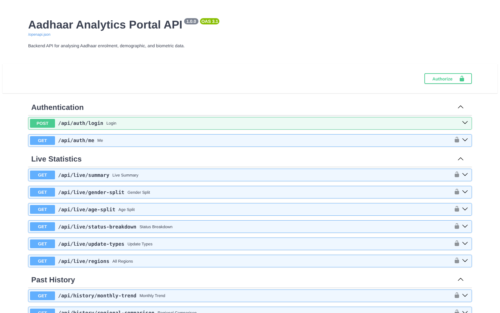

# API

FastAPI generates interactive documentation for every route:

- Swagger UI: http://localhost:8000/docs
- OpenAPI JSON: http://localhost:8000/openapi.json



## Authentication

`POST /api/auth/login` takes **form fields** (`username`, `password`), not JSON,
and returns a JWT valid for 8 hours:

```bash
curl -X POST http://localhost:8000/api/auth/login -d "username=<user>&password=<password>"
# {"access_token": "...", "token_type": "bearer", "role": "SuperAdmin", "full_name": "..."}
```

Send it on every other `/api/*` call as `Authorization: Bearer <token>`.
Roles are `SuperAdmin`, `Analyst` and `Viewer`. Every logged-in role can read;
only `SuperAdmin` can use `/api/import/*`. Users are created with
`python scripts/create_admin.py`.

## Routes

"Auth" is the minimum role needed. "Any" means any logged-in user.

| Method | Path | Auth | What it returns | Parameters |
|---|---|---|---|---|
| POST | `/api/auth/login` | none | JWT access token (5 attempts/min per IP) | form: `username`, `password` |
| GET | `/api/auth/me` | any | Current user's username, name and role | |
| GET | `/api/live/summary` | any | KPI totals for today, or the latest day with data | `region_code` |
| GET | `/api/live/gender-split` | any | Enrolments per gender | `region_code`, `days` (default 30, `0` = all time) |
| GET | `/api/live/age-split` | any | Enrolments per age group | `region_code`, `days` |
| GET | `/api/live/status-breakdown` | any | Enrolments per status, all time | |
| GET | `/api/live/update-types` | any | Update requests per type | `days` |
| GET | `/api/live/regions` | any | All regions (for filters) | |
| GET | `/api/history/monthly-trend` | any | Monthly enrolments, updates, generated for one year | `year` (default 2024), `region_code` |
| GET | `/api/history/regional-comparison` | any | Enrolments and updates per region in a date range | `start_date`, `end_date`, `limit`, `offset` |
| GET | `/api/history/yearly-growth` | any | Enrolments and generated IDs per year | |
| GET | `/api/history/update-history` | any | Updates per type and status in a date range | `start_date`, `end_date`, `limit`, `offset` |
| GET | `/api/insights/recommendations` | any | Rule-based action items (fixed thresholds, not a model) | |
| GET | `/api/insights/biometric-quality` | any | Average fingerprint, iris and photo scores | |
| GET | `/api/insights/trends-forecast` | any | Last 6 months, 3-month moving average, projected next month | |
| GET | `/api/anomalies/list` | any | Stored anomalies, newest first | `resolved`, `severity`, `limit` (default 200), `offset` |
| GET | `/api/anomalies/detect-surges` | any | Regions where today's enrolments exceed the previous 7-day average by `threshold_pct` | `threshold_pct` (10–500, default 50) |
| GET | `/api/export/summary-report` | any | JSON report for the last 30 days (the PDF export is built from it in the browser) | |
| POST | `/api/import/enrollments/upload` | SuperAdmin | Ingests an enrolment CSV | multipart `file` |
| POST | `/api/import/demographic/upload` | SuperAdmin | Ingests a demographic-update CSV | multipart `file` |
| POST | `/api/import/biometric/upload` | SuperAdmin | Ingests a biometric-quality CSV | multipart `file` |
| GET | `/api/import/predictive/forecast-enrollment` | SuperAdmin | Damped exponential-smoothing forecast | `months_ahead` (1–12, default 3) |
| GET | `/api/import/predictive/growth-patterns` | SuperAdmin | Regions ranked by enrolments in the last 90 days | |
| GET | `/api/import/status` | SuperAdmin | Row counts per table | |
| POST | `/api/chat/ask` | any | Answer from Anthropic Claude, with live aggregate numbers in the prompt (10 requests/min per IP) | JSON: `message`, `history` |
| GET | `/health` | none | `{"status": "ok"}` | |

The pages are served by the same app: `/` (login), `/dashboard`, and static
files under `/css`, `/js` and `/`.

## Pagination

`/api/anomalies/list`, `/api/history/regional-comparison` and
`/api/history/update-history` take `limit` (1–500) and `offset` (≥ 0);
out-of-range values return 422. Results have a stable sort order, so pages do
not overlap.

## Errors, rate limits and CORS

- Validation errors return 422 with FastAPI's standard `detail` list.
- Any unexpected server error returns `500 {"detail": "Internal server error"}`;
  the stack trace is written to the server log, not the response.
- More than 5 login attempts or 10 chat requests per minute from one client IP
  return 429. Change with `LOGIN_RATE_LIMIT` / `CHAT_RATE_LIMIT` (e.g. `20/minute`).
- CORS allows only the origins in `CORS_ORIGINS` (comma-separated; default
  `http://localhost:8000,http://127.0.0.1:8000`). The bundled frontend is
  same-origin and needs none.

## Upload rules

The `/api/import/*/upload` routes check a file before writing anything:

| Problem | Response |
|---|---|
| Filename does not end in `.csv`, file is empty, cannot be parsed, or has no data rows | 400 |
| Larger than `MAX_UPLOAD_MB` (default 10) | 413 |
| Required columns missing | 400, with `detail.missing_columns` |
| `DEMO_MODE=true` | 403 |

Required columns are listed in [DATA.md](DATA.md#csv-formats).

## Chat limits

`POST /api/chat/ask` returns 422 for a `message` over 2,000 characters or
empty, more than 20 `history` items, a history item over 8,000 characters, or
a role other than `user` / `assistant`. Other outcomes:

| Situation | Response |
|---|---|
| `ANTHROPIC_API_KEY` not set, or `anthropic` not installed | 503 |
| Key rejected by Anthropic | 502 (not 401, so the browser does not treat it as an expired login) |
| Anthropic rate limit | 429 |
| Anthropic unreachable or timed out | 503 |
| Other Anthropic API error | 502, without internal details |
| The model declines (refusal) | 200 with a short safe reply |

The prompt contains only aggregate numbers (counts, averages, region names),
capped at 4,000 characters and wrapped in `<dashboard_data>` tags marked as
data. Model and effort default to `claude-opus-5-5` / `low` and can be changed
with `ANTHROPIC_MODEL` / `ANTHROPIC_EFFORT`.

## Quirks worth knowing

- `forecast-enrollment` returns `{"error": "Insufficient historical data"}`
  with status 200 when there are fewer than 3 months of data.
- Its `confidence` field is a fixed `0.75`, not a computed value.
- `monthly-trend` defaults to `year=2024` and `regional-comparison` to
  calendar 2024; the dashboard always passes explicit values.
