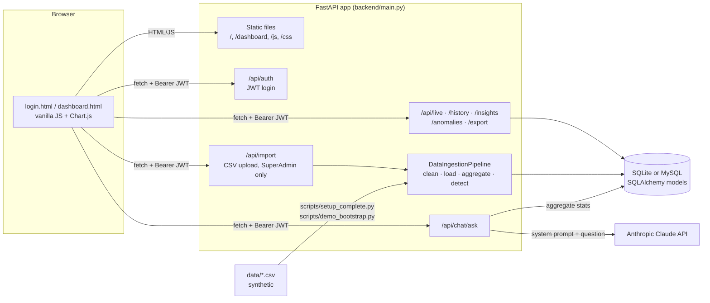

# Architecture

One FastAPI process serves both the JSON API and the static frontend. Data
lives in SQLite (default) or MySQL through SQLAlchemy. The chatbot is the only
part that calls an outside service.

## Walkthrough

1. The browser loads `login.html`, posts the form to `/api/auth/login`, and
   stores the returned JWT in `sessionStorage`.
2. `dashboard.html` calls the read-only routes (`/api/live`, `/api/history`,
   `/api/insights`, `/api/anomalies`, `/api/export`) with that token and draws
   the results with Chart.js. The API base URL comes from `frontend/js/config.js`.
3. Data gets in through `DataIngestionPipeline` (`backend/data_ingestion.py`):
   either the setup scripts load `data/*.csv`, or a SuperAdmin uploads a CSV to
   `/api/import/*`. The pipeline cleans rows, stores them, rebuilds the
   per-day, per-region `daily_stats` table and runs the anomaly rules.
4. Most dashboard numbers are read from `daily_stats` (pre-aggregated counts);
   the gender, age and status splits query `enrollments` directly.
5. `/api/chat/ask` builds a text summary of current aggregates from the
   database (never individual records, capped at 4,000 characters), puts it in
   the system prompt inside `<dashboard_data>` tags, and forwards the question
   to Anthropic Claude (`claude-opus-5-5`) with the async SDK. The API key
   stays on the server.
6. Cross-cutting: login and chat are rate-limited per client IP
   (`backend/rate_limit.py`, slowapi); CORS allows only `CORS_ORIGINS`; any
   unhandled exception becomes a JSON 500 and is logged with its stack trace.

## Code layout

| Path | Contents |
|---|---|
| `backend/main.py` | App setup, CORS, router registration, `/health`, static file serving |
| `backend/rate_limit.py` | slowapi limiter and the login/chat limits |
| `backend/database.py` | Engine and session from `DB_ENGINE` / `DB_URL` / `DB_FILE` (loads `.env`) |
| `backend/models/models.py` | Tables: `regions`, `enrollments`, `updates`, `biometric_data`, `anomalies`, `daily_stats`, `admin_users` |
| `backend/routes/` | One router per area: `auth`, `live_stats`, `history`, `insights`, `anomalies`, `data_export`, `data_import`, `chat` |
| `backend/data_ingestion.py` | CSV cleaning and loading, daily aggregation, anomaly rules, forecast (`PredictiveAnalytics`) |
| `frontend/` | `pages/` (HTML), `js/app.js` (dashboard), `js/chatbot.js`, `js/config.js`, `css/` |
| `database/schema.sql` | Hand-written MySQL schema (the app itself creates tables from the models) |
| `scripts/` | Setup, data generation, admin creation, demo bootstrap, debugging helpers |
| `tests/` | pytest suite, see [TESTING.md](TESTING.md) |

## Analytics logic

All of the analysis is rule-based; there is no trained model.

| Feature | How it works | Code |
|---|---|---|
| Surge detection | A region is flagged when today's enrolments are at least `threshold_pct` % (default 50) above its average over the previous 7 days | `routes/anomalies.py: detect_surges` |
| Stored anomalies | Low fingerprint quality (< 50) in more than 10 records; rejection rate above 15 % over 7 days with more than 20 enrolments in a region | `data_ingestion.py: detect_anomalies` |
| Recommendations | Fixed thresholds: any fingerprint score below 60, rejection rate above 10 % in 30 days, regions with no activity in 7 days, more than 100 pending | `routes/insights.py: recommendations` |
| Trend projection | 3-month moving average adjusted by last month's growth rate | `routes/insights.py: trends_forecast` |
| Forecast | Exponential smoothing (alpha 0.3) with a damped trend; `confidence` is a fixed 0.75 | `data_ingestion.py: PredictiveAnalytics` |

## Deployment

`render.yaml` describes the public demo: a single Render web service that runs
`scripts/demo_bootstrap.py` (builds SQLite from seeded synthetic data and
creates a read-only demo login) and then `uvicorn`. `DEMO_MODE=true` disables
uploads; `ENV=production` makes a missing `JWT_SECRET_KEY` a startup error.
